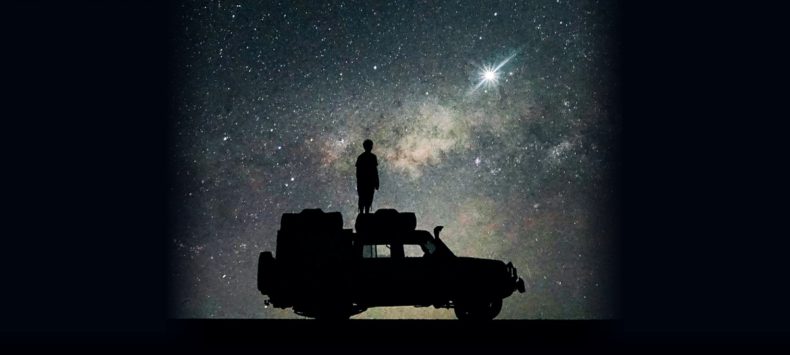

<div align="center">

```text
   _____                  _        _____ _             
  / ____|                (_)      / ____| |            
 | |     ___  ___ _ __ ___  _  ___| (___ | |_ ___  __ _ 
 | |    / _ \/ __| '_ ` _ \| |/ __|\___ \| __/ _ \/ _` |
 | |___| (_) \__ \ | | | | | | (__ ____) | ||  __/ (_| |
  \_____\___/|___/_| |_| |_|_|\___|_____/ \__\___|\__, |
                                                   __/ |
        // COVERT CELESTIAL STEGANOGRAPHY ENGINE  |___/ 
```

### 🛰️ Cryptographically Authenticated Covert Channel Carrier for Astrophotography

[](https://python.org)
[](#-how-it-works)
[](#-cryptographic-envelope)
[](LICENSE)

<br>

<p align="center">
  
</p>

> 🔍 **THE TRICK:** The photograph above looks like a pure night-sky portrait. However, **its photons secretly conceal an encrypted, authenticated transmission**. Try extracting it below!

</div>

---

## ⚡ Interactive Easter Egg: Extract the Hidden Transmission

Clone the repository and run the extractor on the included carrier photograph:

```bash
git clone https://github.com/justavenoir/cosmic-steg.git
cd cosmic-steg

# Extract the secret payload embedded within the starfield
python cosmic_steg.py --extract assets/starlight.png
```

```text
  [+] Inspecting Carrier: assets/starlight.png
  [+] Scanning Photonic LSB Spectrum...
  [🔓] PAYLOAD EXTRACTED SUCCESSFULLY (1,008 bytes):

=================================================================
  🌌 DEEP-SPACE TRANSMISSION INTERCEPT // FREQUENCY: 0x7E3
=================================================================
  [+] SENDER IDENTITY : Avenoir (@justavenoir)
  [+] ROLE            : Cybersecurity Engineer & Space Explorer
  [+] SECURITY LEVEL  : LEVEL-5 [ROOT ACCESS GRANTED]
  [+] PROTOCOL        : POISSON-PHOTONIC-STEGANOGRAPHY v1.0
  [+] TARGET OBJECT   : Star OBJ-01 / Sagittarius A* Vector

  [MISSION DIRECTIVE]
  "Learn how it works. Understand how it breaks. Build it better. Secure it."
=================================================================
```

---

## 🔬 How It Works: Technical Architecture

Steganography is the science of hiding secret communication in plain sight. In ordinary media, modified bits can introduce noticeable visual distortion or detectable statistical anomalies.

**`COSMIC-STEG` uses high-entropy astrophotography to achieve undetectable covert channels:**

```text
 ┌──────────────────────┐
 │ SECRET PAYLOAD/FILE  │
 └──────────┬───────────┘
            │
            ▼
 ┌─────────────────────────────────────────────────────────────────┐
 │ PBKDF2-HMAC-SHA256 KEY DERIVATION (100,000 Iterations + Salt)   │
 └──────────┬──────────────────────────────────────────────────────┘
            │
            ▼
 ┌─────────────────────────────────────────────────────────────────┐
 │ ChaCha20 STREAM CIPHER + HMAC-SHA256 AUTHENTICATION TAG         │
 │ (High entropy makes payload indistinguishable from sensor noise)│
 └──────────┬──────────────────────────────────────────────────────┘
            │
            ▼
 ┌─────────────────────────────────────────────────────────────────┐
 │ ADAPTIVE LSB MODULATION ACROSS 24-BIT RGB PIXEL MATRIX          │
 └──────────┬──────────────────────────────────────────────────────┘
            │
            ▼
 ┌──────────────────────┐
 │ STEGANO-CARRIER PNG  │ (Visually & statistically identical to raw night sky)
 └──────────────────────┘
```

1. **Noise Camouflage:** The natural background of an astrophotograph contains organic sensor photon shot noise and atmospheric scintillation. When our encrypted ciphertext is embedded into the Least Significant Bits (LSBs), it is mathematically and visually indistinguishable from natural sensor noise ($\Delta E \approx 0$).
2. **Authenticated Integrity:** The payload is wrapped in a cryptographic envelope featuring a 32-byte HMAC-SHA256 signature. If an adversary attempts to modify even a single pixel in an effort to corrupt or intercept the channel, the tool immediately flags an `AUTHENTICATION FAILED` exception.
3. **Arbitrary Payloads:** Supports raw text, source code files, cryptographic keys, or binary files (PDF, ZIP, ELF binaries).

---

## 🚀 Usage Guide

### 1. Embed a Secret Message:
```bash
python cosmic_steg.py --embed space.png -m "Classified rendezvous at sector 0x7E3" -o encoded.png
```

### 2. Embed a File with Password Protection:
```bash
python cosmic_steg.py --embed space.png -f mission_brief.pdf -p "CelestialPassphrase!" -o secure_space.png
```

### 3. Extract and Decrypt:
```bash
python cosmic_steg.py --extract secure_space.png -p "CelestialPassphrase!" -o recovered_brief.pdf
```

### 4. Inspect Carrier Capacity:
```bash
python cosmic_steg.py --inspect assets/starlight.png
```
```text
=================================================================
  🛰️  CELESTIAL CARRIER STEGANOGRAPHIC CAPACITY AUDIT
=================================================================
  • Dimensions       : 1200 × 540 px (648,000 pixels)
  • Color Depth      : 24-bit TrueColor RGB
  • Available Carrier: 1,944,000 LSB slots
  • Max Covert Data  : 243,000 bytes (237.30 KB)
  • Transmission Mode: Photonic LSB Delta Modulation
=================================================================
```

---

## 🧪 Automated Testing

Verify the cryptographic pipeline and test suite:

```bash
python -m unittest tests/test_steg.py
```
```text
....
----------------------------------------------------------------------
Ran 4 tests in 0.406s

OK
```

---

## 📜 License

Created by **[Avenoir](https://github.com/justavenoir)** under the **MIT License**. See [LICENSE](LICENSE) for details.
